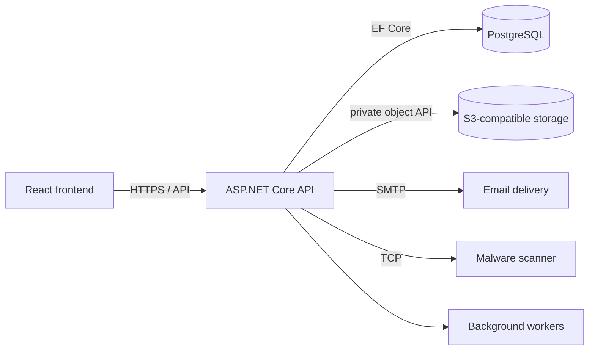

# ProcureFlow architecture

ProcureFlow is a full-stack modular monolith:

- ASP.NET Core 10 provides the HTTP API and background workers.
- React 19 provides the browser client.
- EF Core and one PostgreSQL database provide persistence.
- Docker Compose provides local and VPS deployment topologies.

## System boundary



The browser is not an authorization boundary. The backend derives actor,
organization, branch, and membership context from authenticated state and
verified server data.

## Backend modules

### Accounts and authentication

Handles registration, email confirmation, login, 2FA, JWT access tokens,
refresh-token rotation, logout, password reset, profiles, and user
administration.

### Organizations

Owns organizations, branches, memberships, and business roles. The current
MVP supports one active membership per user.

### Catalog

Owns categories, units of measure, and product records. Reference data is
modeled explicitly instead of relying on unconstrained strings.

### Purchase requests

Owns the purchase-request aggregate, items, status history, monthly budgets,
approval decisions, fulfillment, and attachments. Critical status and budget
transitions are server-controlled and concurrency-protected.

### Notifications

Owns application notifications, preferences, and durable email outbox work.
Domain events that require one transaction are staged in the same unit of work
as the business change.

## Technical layers

```text
API
  Controllers, request/response DTOs, validation, middleware
Application
  Use cases, focused ports, orchestration
Domain
  Entities, value objects, invariants, status transitions
Infrastructure
  EF Core stores, integrations, background workers, migrations
Shared
  Cross-boundary response and settings contracts
```

New work should use a focused vertical slice:

```text
API/Modules/<Module>/<UseCase>/
Application/Modules/<Module>/<UseCase>/
Infrastructure/Modules/<Module>/<UseCase>/
UnitTests/Modules/<Module>/<UseCase>/
```

A folder is not a boundary by itself. The boundary is complete only when
dependencies point inward, registration is module-local, and tests cover the
public behavior.

## Important flows

### Authentication

1. Credentials are verified by the auth service.
2. The backend either issues a session or starts an email 2FA challenge.
3. Access-token claims are used only after framework token validation.
4. The refresh token is held in an HttpOnly cookie and rotated in the database.
5. The frontend stores the access token and rebuilds the user session through
   `/api/auth/me`.

Details: [JWT architecture](JWT_ARCHITECTURE.md) and
[email flows](EMAIL_2FA_FLOWS.md).

### Purchase-request transition

1. The API authenticates the caller and validates input.
2. A use case resolves current membership and authorizes the resource.
3. The aggregate validates the state transition.
4. EF Core stages domain data, status history, budget changes, notifications,
   and outbox records when they must be atomic.
5. One `SaveChangesAsync` commits the transaction.
6. A stale concurrency token maps to `409 Conflict`.

### Frontend bootstrap

1. Runtime configuration is loaded from `/api/runtime-config`.
2. The auth context attempts session restoration.
3. The bootstrap gate waits for both results.
4. The application renders protected routes and the shell.

Runtime feature flags affect navigation and availability, not server-side
authorization.

## Persistence

The active database model includes:

- users and security tokens;
- organizations, branches, and memberships;
- categories, units of measure, and products;
- purchase requests, items, history, decisions, budgets, and attachments;
- notifications, email preferences, and email outbox messages.

Historical EF migrations can mention retired starter entities. They must not be
treated as active modules.

## Operations

- `/health/live` checks the process.
- `/health/ready` checks required readiness dependencies.
- `/health/workers` reports durable-worker freshness.
- `/health/storage`, `/health/malware-scanner`, and `/health/email` expose
  dependency-specific status.
- Each response receives an `X-Correlation-ID`.

Deployment, backup, restore, and rollback are documented in the
[deployment runbook](DEPLOYMENT_RUNBOOK.md).

## Architecture constraints

- Keep one modular monolith and one PostgreSQL database unless a measured
  constraint proves another boundary.
- Keep domain invariants outside controllers and EF adapters.
- Use explicit ports for cross-module work; do not query another module's
  `DbSet` directly.
- Keep server authorization independent from frontend route visibility.
- Use an explicit migration for schema changes.
- Record durable architectural decisions as short ADRs.
